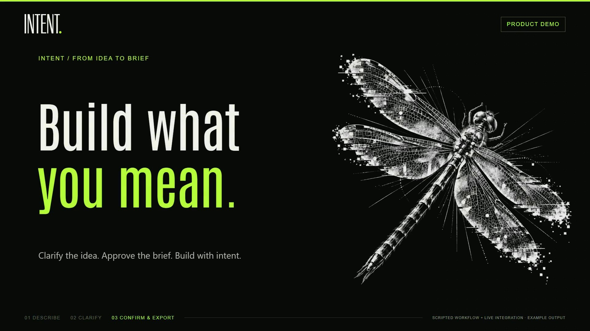

# Intent demo

A 2:00 walkthrough of Intent, including its current Graph & notes view and a
recorded live integration with Nebius Token Factory and NVIDIA Nemotron.

- [Watch or download the silent video](intent-demo-silent.mp4)
- [Watch or download the video with original instrumental music](intent-demo-music.mp4)

Both versions are 1920 × 1080, 30 fps, H.264 MP4, without narration.
Chapters appear in one bottom progress bar; each scene focuses on a single idea.

## Earlier versions

- **Previous clean cut (2:00):** [with music](archive/previous/intent-demo-music.mp4)
  · [silent](archive/previous/intent-demo-silent.mp4). Bottom chapter bar with fades
  through black, before the animated transitions and graph-entry trim.
- **Original demo (2:20):** [with music](archive/original/intent-demo-music.mp4)
  · [silent](archive/original/intent-demo-silent.mp4). The version published in
  commit `d6d270a`.

## Key moments

- **0:50:** Current Graph & notes canvas, followed by Markdown editing.
- **1:23:** Nebius Token Factory endpoint and NVIDIA Nemotron model routing.
- **1:32:** Recorded live Nano/Super clarification response in Intent.
- **1:43:** Redacted API evidence: eight Nano and six Super HTTP 200 responses,
  including validation repair attempts.

## What the recording demonstrates

The live recording covers one clarification turn using Nano and Super through
Nebius Token Factory. It ends awaiting further user clarification; it does not
show an approved live brief or agent build. Ultra is described as the configured
brief compiler and was not invoked for this recording. Scripted workflow and
prebuilt preview sections remain labeled.

Private recordings, session databases, provider reports, and production working
files remain local under the ignored `.data/` directory. Only the final viewing
assets are published here.
